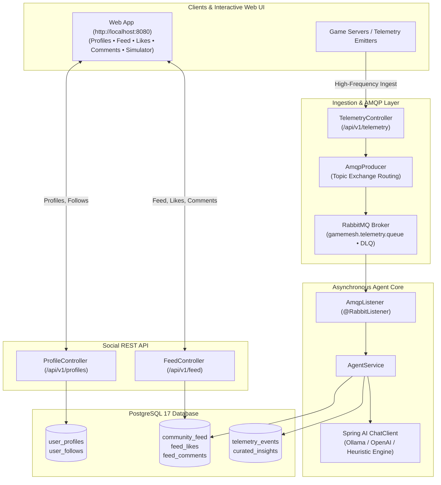

# GameMesh AI 🎮🤖 - The AI-Powered Gaming Social Network

**GameMesh AI** is a production-grade, local-first gaming social media platform engineered with **Java 23**, **Spring Boot 3.4.x**, **PostgreSQL 17**, **RabbitMQ**, and **Spring AI**. 

Unlike traditional social networks where users only post manual updates, GameMesh AI transforms raw gameplay telemetry (clutch eliminations, rank promotions, server crash incidents, toxic chat) into an **automated, AI-curated live community feed** with player profiles, social interactions (likes, comments, follows), and automated toxicity moderation.

---

## 🏛 Platform Architecture



---

## 🚀 Quick Start Guide

### 1. Start Backing Infrastructure (Docker)
Ensure Docker Desktop is running, then start PostgreSQL and RabbitMQ:

```powershell
cd "C:\Users\NIBIN G VARGHESE\.gemini\antigravity\scratch\gamemesh-ai"
docker compose up -d
```

| Service | Port(s) | Default Credentials | Description |
| :--- | :--- | :--- | :--- |
| **PostgreSQL 17** | `5432` | `postgres` / `postgres` (`gamemesh` DB) | Relational database |
| **RabbitMQ Broker** | `5672` | `guest` / `guest` | AMQP messaging broker |
| **RabbitMQ UI** | `15672` | `guest` / `guest` | Web management dashboard |

---

### 2. Start the Application
Run the backend with the included Maven wrapper:

```powershell
.\mvnw.cmd spring-boot:run
```

---

### 3. Open the Interactive Gaming Social Network UI
Navigate to **[http://localhost:8080](http://localhost:8080)** in your browser!

You can:
- **Browse the Live Community Feed**: Automatically updating match events, clutch highlights, and crash notices.
- **Interact**: Like posts in real-time (❤️) and write comments (💬).
- **Inspect Gamer Profiles**: View esports rank badges, reputation ratings, followers, and bio cards.
- **Use the Built-in Match Simulator**: Click the simulator action buttons on the right sidebar to trigger live 1v3 clutches, server crash alerts, toxic chat interceptions, or 25-event bursts, and watch them stream into the feed instantly!

---

## 📡 REST API Reference

### 1. Social Community Feed (`/api/v1/feed`)
| Method | Endpoint | Description |
| :--- | :--- | :--- |
| `GET` | `/api/v1/feed` | Retrieve live community feed with likes & comment counts. |
| `GET` | `/api/v1/feed?severity=CRITICAL` | Filter feed by severity (`LOW`, `MEDIUM`, `HIGH`, `CRITICAL`). |
| `GET` | `/api/v1/feed/{id}` | Retrieve specific feed item by ID. |
| `POST` | `/api/v1/feed/{id}/like?gamerTag=vortex_99` | Like / Unlike a feed item. |
| `POST` | `/api/v1/feed/{id}/comments` | Post a comment to a feed item (`gamerTag`, `commentText`). |
| `GET` | `/api/v1/feed/{id}/comments` | Retrieve comments on a feed item. |

### 2. Gamer Profiles & Social Graph (`/api/v1/profiles`)
| Method | Endpoint | Description |
| :--- | :--- | :--- |
| `GET` | `/api/v1/profiles/{gamerTag}` | Retrieve gamer profile (rank, bio, reputation, followers). |
| `GET` | `/api/v1/profiles/leaderboard` | Get top gamer leaderboard by reputation score. |
| `POST` | `/api/v1/profiles` | Register new gamer profile. |
| `POST` | `/api/v1/profiles/{targetTag}/follow?followerTag={myTag}` | Follow another gamer. |
| `DELETE` | `/api/v1/profiles/{targetTag}/follow?followerTag={myTag}` | Unfollow a gamer. |

### 3. High-Frequency Telemetry Ingestion (`/api/v1/telemetry`)
| Method | Endpoint | Description |
| :--- | :--- | :--- |
| `POST` | `/api/v1/telemetry` | Ingest single game telemetry payload (returns `202 ACCEPTED`). |
| `POST` | `/api/v1/telemetry/batch` | High-frequency batch ingestion array. |
| `POST` | `/api/v1/telemetry/mock/simulate?count=25` | Generate burst of realistic mock events. |
| `POST` | `/api/v1/telemetry/mock/failure` | Trigger simulated failure for retry & DLQ verification. |

---

## 🧪 Automated Test Suite

Run all unit & integration tests:
```powershell
.\mvnw.cmd test
```
Covering:
- `UserProfileServiceTest`: Profile creation, uniqueness, and follow graph.
- `SocialInteractionServiceTest`: Likes, unliking, and comment threads.
- `FeedControllerTest`: Feed pagination, like toggle, and comment endpoints.
- `AgentServiceTest`: Autonomous Spring AI digestion, error detection, and performance spike handling.
- `AmqpProducerTest` & `AmqpListenerTest`: AMQP message dispatching and DLQ routing.
